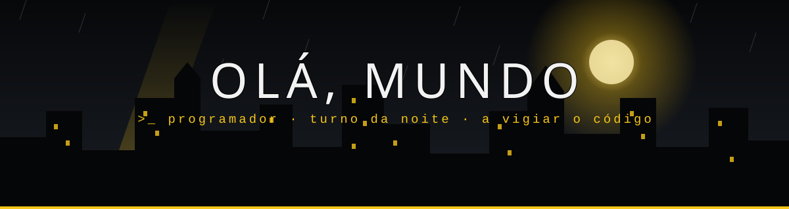
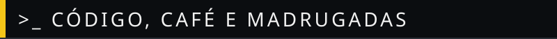
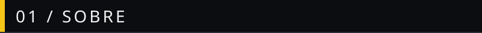

## 01 / Sobre

Sou **Willian Silva**, desenvolvedor focado em criar projetos limpos, funcionais e bem organizados. Trabalho melhor quando a cidade já está a dormir.

- **Classe:** desenvolvedor em construção
- **Estilo:** interfaces minimalistas
- **Código de conduta:** qualidade e clareza em vez de excesso
- **Missão:** estar sempre a melhorar as minhas habilidades
- **Localização:** Setúbal, Portugal

## 02 / Arsenal

◆ **LINGUAGENS** `JavaScript` `HTML5` `CSS3` `Python`  
◆ **FERRAMENTAS** `Git` `GitHub`

## 03 / Casos

| Caso | Briefing |
| --- | --- |
| ◆ **[NOME DO PROJETO 1](https://github.com/WillianSilvaGITH/REPO1)** | Uma ou duas frases sobre o que faz e para quem. |
| ◆ **[NOME DO PROJETO 2](https://github.com/WillianSilvaGITH/REPO2)** | Uma ou duas frases sobre o que faz e para quem. |
| ◆ **[NOME DO PROJETO 3](https://github.com/WillianSilvaGITH/REPO3)** | Uma ou duas frases sobre o que faz e para quem. |

> Substitui os três casos pelos teus repositórios e fixa-os (pins) no perfil.

## 04 / Relatório

## 05 / Sinal

*Precisas de um site, uma automatização ou uma aplicação à medida? O canal está aberto.*

- **GitHub:** [@WillianSilvaGITH](https://github.com/WillianSilvaGITH)
- **E-mail:** [willian.silva.wedigitek@gmail.com](mailto:willian.silva.wedigitek@gmail.com)

*"Nada na vida tem graça se você não lutar para conquistar o que deseja."*

Ícones: [Skill Icons](https://skillicons.dev/) · Badges: [Shields.io](https://shields.io/) · Estatísticas: [github-readme-stats](https://github.com/anuraghazra/github-readme-stats) e [streak-stats](https://github.com/DenverCoder1/github-readme-streak-stats)

